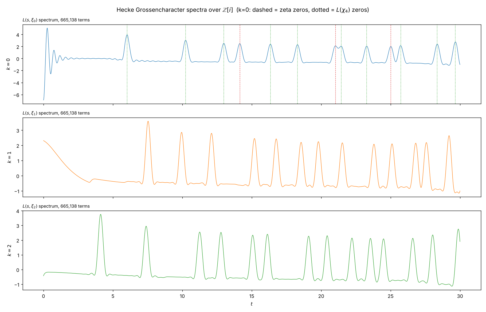

# prime-pane-spectra

Put the primes on a pane of glass. Lay a second pane on top. Slide them
against each other and watch what happens to the light.

There are only three ways to slide — turn, scale, shear — and they are the
three one-parameter subgroups of SL(2,ℝ). Each reaches a different piece of
arithmetic, and the differences are stark. **Turn** the panes and you find the
lattice and nothing else: at the Pythagorean angles the primes snap into
coincidence, 568 exact hits where a generic angle gives zero, and every bit of
it dissolves into the fact that primes are odd. **Scale** them instead — set
the primes on a logarithmic spiral, where turning and growing become the same
gesture — and the interference pattern is the Riemann zeros, all thirteen
below *t* = 60, most to four decimal places. **Shear** them and you are
counting prime pairs, the departure angle selecting which gap you count,
Hardy–Littlewood setting the brightness. Half of all angles go dark: the
parity obstruction, visible to the eye.

Then change the ring. On ℤ² the angle of a lattice point carries nothing,
which is why turning the panes found only parity. On ℤ[i] the angle of a prime
carries an entire tower of *L*-functions — one for every Hecke
Grossencharacter — and the same construction reads them off the geometry.
Weight by ξ₀ and the Riemann zeros arrive interleaved with the zeros of
*L*(*s*, χ₄), including a pair 0.43 apart resolved separately. Weight by ξ₁
and a weight-5 modular form's zeros appear instead. Weight by ξ₂ and they are
replaced again.

None of this is new mathematics. All of it is visible in a few seconds of
compute.

| pane motion | subgroup | reaches | outcome |
| --- | --- | --- | --- |
| rotate | elliptic SO(2) | coincidence lattices of ℤ² | **no prime content** — parity explains all of it |
| lift, lines to a focus | diagonal | ζ zeros via Mellin | all 13 zeros below *t*=60 recovered |
| lift, lines parallel | unipotent | prime pair correlations | Hardy–Littlewood singular series, 302 primes |
| rotate, over **ℤ[i]** | — | Hecke *L*-functions | three families validated to ~0.005 |

Everything here reproduces known mathematics. Nothing in it is a new theorem. What it is: a validated, fast instrument, and a reasonably honest account of getting one working.

---

## The strongest result: a Hecke *L*-function spectrometer over ℤ[i]

On ℤ² the angle of a lattice point carries no arithmetic, which is why rotation found only parity. On ℤ[i] the angle of a prime carries a great deal — it is what Hecke Grossencharacters see. Weighting the Mellin spectrum by ξ*ₖ*(π) = (π/|π|)^(4k) produces, for each *k*, the zeros of a different *L*-function.

```
python3 src/gaussian_hecke.py --X 1e7 --tmax 30
python3 src/hecke_zeros.py                     # independent reference zeros
```

**k = 0** must show the Riemann zeros *and* the zeros of *L*(*s*, χ₄), since ζ_ℚ(i) = ζ · *L*(·, χ₄). It does — 13 of 13 below *t* = 30, including the pair at 21.0220 (zeta) and 21.4506 (χ₄) resolved separately at a resolution of 0.390:

| expected | source | found | Δ |
| --- | --- | --- | --- |
| 6.0209 | χ₄ | 6.0240 | +0.0031 |
| 14.1347 | zeta | 14.1360 | +0.0013 |
| 21.0220 | zeta | 21.0280 | +0.0060 |
| 21.4506 | χ₄ | 21.4360 | −0.0146 |
| 29.6564 | χ₄ | 29.6680 | +0.0116 |

The χ₄ reference zeros are computed from Hurwitz zeta inside the script, not taken from a table.

**k = 1** is newform **4.5.b.a** (weight 5, level 4, CM by ℚ(i)). The identification is forced by the coefficients: *a*₂ = (1+i)⁴ = −4 and *a*₅ = (2+i)⁴+(2−i)⁴ = −14, and the theta series computed in `hecke_zeros.py` gives 1, −4, 0, 16, −14, 0, 0, −64, 81 — LMFDB's *q*-expansion term for term.

| computed | measured | Δ |
| --- | --- | --- |
| 7.5352 | 7.5360 | +0.0008 |
| 9.9484 | 9.9480 | −0.0004 |
| 12.1028 | 12.1040 | +0.0012 |
| 15.1946 | 15.1960 | +0.0014 |
| 16.7627 | 16.7600 | −0.0027 |
| 18.5548 | 18.5560 | +0.0012 |
| 21.5232 | 21.5240 | +0.0008 |

**k = 2** (weight 9): 8 of 8, maximum error 0.007. The reference zeros come from the completed *L*-function via incomplete gamma — no code shared with the spectrum.



---

## What the other panes gave

**Rotation (`moire_primes.py`).** The magic angles are real and indexed by primes: a rotation maps ℤ² onto a sublattice exactly when cos θ and sin θ are rational, and the coincidence index Σ = *a*²+*b*² factors entirely into primes ≡ 1 (mod 4). At a Pythagorean angle the prime set gives 568 exact coincidences against zero at generic angles.

But it is not about primes. Against structure-matched nulls at *N* = 200,000:

| point set | coincidences | ratio to primes |
| --- | --- | --- |
| primes | 1978 | 1.00 |
| Cramér expectation (δ²) | 967 | 2.04 |
| random integers | 979 | 2.02 |
| random **odd** integers | 1984 | 1.00 |
| coprime to 2,3,5,7,11 | 1923 | 1.03 |

The 2× excess over naive expectation is parity. Random odd integers reproduce it to 0.3%.

**Dilation (`moire_primes.py`, section D).** Embedding primes on a log spiral makes rotation and scaling the same operation, so the group is ℂ* and the analysis is Mellin. All 13 zeta zeros below *t* = 60 from primes to 10⁶, most to four decimals, 14 peaks total.

**The lift (`lift_resonance.py`, `resolving_angles.py`, `aperture.py`).** A lift at departure angle φ on a *q*-column pane translates by the integer shift *s*, so the angle selects which prime gap is counted. Dynamic range across departure angle: **187,282×**, half of all angles giving exactly zero (parity obstruction). Measured/Hardy–Littlewood = 0.9989 ± 0.0020.

Inverse design: the angles resolving a target prime *r* are the directions in Λ*ᵣ* ∩ Λ₂, and reading the whole lattice rather than one angle per prime fits 302 primes simultaneously, every β*ᵣ* consistent with 1 (pull mean −0.32, sd 0.93, zero outliers beyond 3σ), extending reach from *r* ≈ 101 to *r* = 997.

---

## The retraction

With the instrument sharp enough, the fitted constant stopped matching: β₀ = 0.27739 ± 0.00005 against log(2*C*₂) = 0.27788, a **−9.4σ** deficit. It survived a parameter-free estimator, a ratio-space estimator immune to Jensen bias, disjoint-half splits and a block bootstrap, and stayed negative at every one of 30 cumulative checkpoints across three decades.

It was an artifact of correlation. Cumulative checkpoints share every prime below the smaller one, so a drifting fluctuation produces exactly that signature. Differencing into **disjoint** intervals (`interval_test.py`), the signs scatter: 21/28 negative, *t* = −1.36, and the deficit decays as *N*^−0.487 — the *N*^−1/2 of a statistical fluctuation.

Three independent tests agree:

| test | result |
| --- | --- |
| sign of disjoint-interval deficits | scatters, 21/28, *t* = −1.36 |
| significance vs *N* | decays, trend −0.125 |
| interval exponent | −0.487, i.e. *N*^−1/2 |

**There is no second-order term. The leading Hardy–Littlewood form is correct.** What the sweep measured is the error term's magnitude, and it is the size the conjecture expects.

---

## Four bugs that reported the opposite of the truth

Kept because they are the useful part.

1. **The ε trap.** Coincidence peaks have angular width ε/*R* and are delta-like. At ε = 0.3 the magic-angle signal inverted to 0.71×; at ε = 0.01 it was 680×. Same data, same angles.
2. **Envelope before peaks.** The raw Mellin spectrum falls off so steeply that a naive peak-finder returned every peak below *t* = 18 and matched zero zeta zeros. A Hann taper in log *n* plus local-RMS normalization recovered all 13.
3. **Correlated samples.** Cumulative checkpoints manufactured a 9.4σ result from a fluctuation (above).
4. **A word-boundary bug.** In the bit-packed counter the shifted operand is one word shorter than the source, so without slack the last word fell outside the overlap and up to 64 values per segment went uncounted at the largest shifts. It passed its own byte-vs-bit check by luck — at that segment size the arithmetic came out flush. Caught only when a resume path gave an independent comparison.

---

## The numerics

`sweep_fast.py` is a segmented, bit-packed prime-pair correlation engine: *O*(segment) memory rather than *O*(*N*), checkpointed, resumable, 2.4× the byte-wise version, five decades in a couple of hours on two cores.

Validation anchors: π₂(10⁸) = 440,312 and π₂(10⁹) = 3,424,506, both matching published values; byte-vs-bit identical on all 600 shifts at four segment sizes; and `resume_sweep.py --selftest` requires a resumed run to match a direct one exactly.

```
python3 src/sweep_fast.py --check                       # verify the counter
python3 src/sweep_fast.py --nmax 1e11 --seg 1e8         # the sweep
python3 src/resume_sweep.py --json sweep_1e11.json --nmax 1e11
python3 src/interval_test.py sweep_1e11.json            # the decisive test
```

---

## A closing note

The explicit formula is Riemann's, from 1859; the singular series is Hardy and
Littlewood's, from 1923; the zeros reproduced here sit in a public catalogue
anyone can check, and I checked them. Nothing in this repository extends that
mathematics by a single theorem. But there is a real difference between
reading that the primes carry a spectrum and watching it resolve on your own
machine — seeing a frequency you did not put in rise cleanly out of a sum over
prime angles, land on 6.0209, and stay there as you push the sieve further.
The primes stop reading as static scattered along a line and start reading as
what the mathematics has always said they are: nodes in a resonant structure,
with geometry and arithmetic as two views of one object. The instrument that
shows this is small. It fits in ten files, runs on two cores, and every claim
it makes is checked against something computed independently. It is pointed at
ℤ and ℤ[i] because those are the rings I reached for. Point it somewhere else.

## License

MIT.
